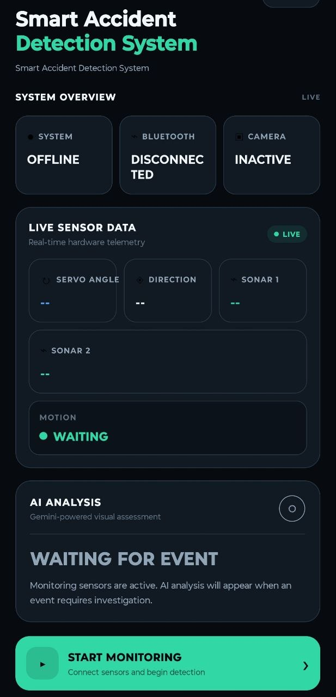

# MINI DETECTIVE — Smart Accident Detection System

A React Native Android application for **smart accident detection and monitoring** using an ESP32-based sensor system, Bluetooth Low Energy (BLE), the phone's camera, and Google's Gemini API.

The app connects to an ESP32 device named `MINI-DETECTIVE`, receives sensor data from two ultrasonic sensors and a motion sensor, monitors the surrounding scene through the phone's rear camera, and uses Gemini to analyze captured evidence when the prototype accident-detection trigger is activated.

Each phone runs the same application. A locally configured **Monitoring Key** authorizes a phone to start a monitoring session. No accounts, login system, or user roles are required.

> **Project status:** Functional prototype / academic project  
> **Platform:** Android  
> **Framework:** React Native 0.87  
> **Hardware:** ESP32 + ultrasonic sensors + motion sensor + servo

## 📱 App Screenshot

<p align="center">
  
</p>

## ✨ Key Features

- 📡 **ESP32 Bluetooth Low Energy connectivity**
- 📷 **Real-time rear-camera monitoring**
- 🚨 **Prototype accident-detection trigger**
- 🤖 **Gemini-powered accident analysis**
- 📊 **Structured accident verdict and confidence**
- 📜 **Event history and accident records**
- 🔐 **Monitoring Key protected monitoring access**
- 🧪 **Demo mode without physical ESP32 hardware**
- 🔵 **BLE sensor packet parsing and validation**
- 📱 **Native Android integration**
- 🧪 **Jest unit tests for core services and utilities**
- 🧩 **Modular service-based application architecture**

## 🧠 How It Works

The system combines physical sensor data with camera evidence.

```text
                    ┌─────────────────────┐
                    │        ESP32        │
                    │                     │
                    │  Servo              │
                    │  Ultrasonic ×2      │
                    │  Motion Sensor      │
                    └──────────┬──────────┘
                               │
                         Bluetooth LE
                               │
                               ▼
                    ┌─────────────────────┐
                    │    Android Phone    │
                    │                     │
                    │  BluetoothService   │
                    └──────────┬──────────┘
                               │
                         SensorData
                               │
                               ▼
                    ┌─────────────────────┐
                    │ MonitoringContext   │
                    │                     │
                    │ Application State   │
                    └──────────┬──────────┘
                               │
                 ┌─────────────┴─────────────┐
                 │                           │
                 ▼                           ▼
        ┌─────────────────┐        ┌────────────────────┐
        │ Rear Camera     │        │ Sensor Information │
        │ Vision Camera   │        │                    │
        └────────┬────────┘        └─────────┬──────────┘
                 │                           │
                 └─────────────┬─────────────┘
                               │
                               ▼
                    ┌─────────────────────┐
                    │ Accident Detection  │
                    │      Service        │
                    └──────────┬──────────┘
                               │
                         Trigger detected
                               │
                               ▼
                    ┌─────────────────────┐
                    │   GeminiService     │
                    │                     │
                    │      Gemini API      │
                    └──────────┬──────────┘
                               │
                               ▼
                    ┌─────────────────────┐
                    │ AccidentAnalysis    │
                    │                     │
                    │ Verdict             │
                    │ Confidence          │
                    │ Explanation         │
                    └──────────┬──────────┘
                               │
                               ▼
                    ┌─────────────────────┐
                    │ Dashboard / Event   │
                    │       History       │
                    └─────────────────────┘
```

## 🏗️ Architecture

The application follows a modular architecture built around React Context and dedicated services.

```text
ESP32
 │
 │ BLE
 ▼
BluetoothService
 │
 │ SensorData
 ▼
MonitoringContext
 │
 ├── Monitoring Screen
 │       │
 │       ├── Rear Camera
 │       │
 │       └── AccidentDetectionService
 │                    │
 │                    │ "Worth analyzing?"
 │                    ▼
 │              GeminiService
 │                    │
 │                    ▼
 │                Gemini API
 │                    │
 │                    ▼
 │             AccidentAnalysis
 │
 └── Dashboard / Event History
              │
              ▼
        BackendService
        (future backend seam)
```

The project intentionally keeps hardware communication, accident detection, Gemini integration, application state, navigation, and UI concerns separated.

## 🛠️ Tech Stack

### Mobile Application

- React Native 0.87
- TypeScript
- React Context API
- React Navigation
- React Native Vision Camera
- React Native BLE library
- Jest
- Android Native / Kotlin

### AI

- Google Gemini API
- Structured accident analysis
- JSON response parsing
- Confidence validation

### Hardware Communication

- ESP32
- Bluetooth Low Energy
- Nordic-UART-style GATT service
- Servo motor
- 2× ultrasonic sensors
- Motion sensor

### Development

- Node.js
- npm
- Java 17
- Android SDK
- Gradle
- Git / GitHub
- VS Code

## 📂 Project Structure

```text
MINI-DETECTIVE/
│
├── android/                         # Native Android project
│
├── src/
│   ├── config/
│   │   └── appConfig.ts            # Local application configuration
│   │
│   ├── types/
│   │   └── ...                     # Shared TypeScript types
│   │
│   ├── context/
│   │   └── MonitoringContext.tsx   # Global monitoring state
│   │
│   ├── services/
│   │   ├── BluetoothService.ts     # BLE communication
│   │   ├── GeminiService.ts        # Gemini API integration
│   │   ├── AccidentDetectionService.ts
│   │   └── BackendService.ts       # Future backend integration seam
│   │
│   ├── utils/
│   │   └── direction.ts            # Servo angle → direction
│   │
│   ├── navigation/
│   │   └── AppNavigator.tsx
│   │
│   ├── screens/
│   │   ├── HomeScreen
│   │   ├── MonitoringAccessScreen
│   │   ├── MonitoringScreen
│   │   └── EventScreen
│   │
│   └── components/
│       ├── StatusCard
│       ├── SensorCard
│       └── VerdictCard
│
├── __tests__/                       # Jest unit tests
│
├── screenshots/                     # Project screenshots
│
├── App.tsx
├── index.js
├── package.json
├── package-lock.json
├── babel.config.js
├── metro.config.js
├── jest.config.js
├── tsconfig.json
└── README.md
```

## ⚙️ Prerequisites

Before running the project, install:

- Node.js v20+
- npm 11.x
- Java 17 (OpenJDK)
- Android SDK
- Android platform tools
- `adb`
- A physical Android phone with USB debugging enabled, or an Android emulator
- ESP32 hardware for real BLE operation

The project was developed and tested using:

```text
Node.js 24.14.0
npm 11.x
Java 17
React Native 0.87
Windows 11
```

A physical **Motorola Edge 50 Pro** was used as the primary test device.

## 🚀 Installation

Clone the repository:

```bash
git clone https://github.com/Rakibul-Islam-Rahat/ACCIDENT-DETECTIVE.git
cd ACCIDENT-DETECTIVE
```

Install dependencies:

```bash
npm install
```

## 🔑 Application Configuration

Open:

```text
src/config/appConfig.ts
```

Configure the following values:

| Constant | Description |
|---|---|
| `MONITORING_KEY` | PIN/passphrase required to start monitoring |
| `GEMINI_API_KEY` | Google Gemini API key |
| `GEMINI_MODEL` | Gemini model available to your API key |
| `DEMO_MODE` | Enables/disables simulated ESP32 sensor data |

Example:

```typescript
MONITORING_KEY: '2580'
```

### ⚠️ API Key Security

Do **not** commit a real Gemini API key to GitHub.

For a production application, the Gemini API request should be moved behind a secure backend so that the API key is not embedded inside the Android application.

The repository is intentionally configured so that the required API key can remain empty during initial setup.

## ▶️ Running the Application

Start Metro:

```powershell
npx react-native start --reset-cache
```

In another terminal, connect an Android phone through USB and verify:

```powershell
adb devices
```

Then run:

```powershell
npx react-native run-android
```

## 🧪 Demo Mode

The application includes a **Demo Mode** so that the core application can be demonstrated without an ESP32.

Set:

```text
DEMO_MODE = true
```

When Demo Mode is enabled:

- The monitoring screen still uses the real phone camera.
- No physical ESP32 is required.
- Bluetooth communication is simulated.
- The application reports a simulated `CONNECTED` state.
- Realistic sensor packets are generated periodically.
- Generated sensor values are internally marked as demo data.
- The UI identifies the source as `DATA SOURCE: DEMO DATA`.
- The Gemini analysis pipeline can still be demonstrated if the Gemini configuration is provided.

Once the ESP32 is available, change:

```text
DEMO_MODE = false
```

## 📡 ESP32 / BLE Communication

The Android application communicates with an ESP32 device named:

```text
MINI-DETECTIVE
```

### BLE Service

```text
Service UUID:
6e400001-b5a3-f393-e0a9-e50e24dcca9e
```

### Characteristics

```text
RX — Phone → ESP32
6e400002-b5a3-f393-e0a9-e50e24dcca9e

TX — ESP32 → Phone
6e400003-b5a3-f393-e0a9-e50e24dcca9e
```

The expected TX payload format is:

```text
SERVO:90,S1:25,S2:30,MOTION:YES
```

The application parses the packet into structured sensor data.

`parseSensorPacket()` is designed to tolerate:

- Whitespace
- Newlines
- Partial fields
- Unexpected/garbage input

Invalid packets return `null` rather than crashing the application.

## 🚨 Accident Detection

The current accident-detection mechanism is intentionally a **prototype heuristic**, not a trained machine-learning model.

The trigger currently considers sensor information such as:

- Motion state
- Ultrasonic sensor changes
- Sensor-derived movement conditions

When the heuristic determines that an event is worth analyzing, the application can capture evidence and send it through the Gemini analysis pipeline.

```text
Sensor Event
     │
     ▼
AccidentDetectionService
     │
     │ Trigger?
     ├── No ──→ Continue Monitoring
     │
     └── Yes
          │
          ▼
      Evidence Capture
          │
          ▼
      GeminiService
          │
          ▼
       Gemini API
          │
          ▼
    AccidentAnalysis
```

## 🤖 Gemini AI Analysis

The Gemini integration is handled by:

```text
src/services/GeminiService.ts
```

The service:

1. Sends captured evidence for analysis.
2. Requests a structured accident assessment.
3. Parses the returned response.
4. Validates the JSON structure.
5. Validates the accident verdict.
6. Validates the confidence range.
7. Returns a structured `AccidentAnalysis` object to the application.

The parser also handles fenced JSON responses and rejects malformed or invalid responses safely.

## 📷 Camera Monitoring

The application uses the phone's rear camera through:

```text
react-native-vision-camera
```

Camera permission is requested only when monitoring is actually started.

The application does not request camera permission immediately on launch.

## 🔐 Monitoring Access

Every phone runs the same application.

There are:

- No user accounts
- No login system
- No role management

Instead, a locally configured **Monitoring Key** controls access to the monitoring session.

```text
User
 │
 ▼
Monitoring Access Screen
 │
 ├── Incorrect Key → Access Denied
 │
 └── Correct Key
        │
        ▼
   Monitoring Screen
```

## 🔒 Android Permissions

Permissions are requested at runtime only when they are needed.

### Camera

Requested when the monitoring screen starts.

### Bluetooth

For Android 12+:

```text
BLUETOOTH_SCAN
BLUETOOTH_CONNECT
```

For older Android versions, the application also handles the relevant legacy Bluetooth/location permissions.

If a permission is denied, the application displays an appropriate message and provides a retry path rather than crashing.

## 🧪 Testing

Run TypeScript validation:

```powershell
npx tsc --noEmit
```

Run Jest tests:

```powershell
npx jest
```

The test suite covers important application logic including:

### BLE Packet Parsing

- Valid packets
- Partial packets
- Malformed packets
- Invalid input

### Direction Mapping

Servo angle is mapped as:

```text
angle < 80      → LEFT
80–100          → CENTER
angle > 100     → RIGHT
```

### Gemini Response Parsing

Tests include:

- Valid JSON
- Fenced JSON
- Invalid verdict
- Out-of-range confidence
- Non-JSON responses

## 📦 Release Build

To create an Android release APK:

```powershell
cd android
./gradlew assembleRelease
```

On Windows, you can also use:

```powershell
gradlew.bat assembleRelease
```

> The current prototype reuses the debug signing configuration for release builds. A proper release keystore should be configured before distributing the application outside development/testing environments.

## 🏗️ Gradle Configuration

The Android project uses the Gradle configuration required by the React Native 0.87 setup.

The project uses:

```text
Gradle 9.4.1
Java 17+
```

React Native 0.82+ uses the New Architecture, and this project is configured accordingly.

The Gradle wrapper configuration pins the required Gradle version.

If the Gradle wrapper JAR needs to be generated on a fresh environment, a Gradle distribution can be downloaded temporarily and used to generate the wrapper:

```powershell
cd android

Invoke-WebRequest -Uri "https://services.gradle.org/distributions/gradle-9.4.1-bin.zip" -OutFile "$env:TEMP\gradle-9.4.1-bin.zip"

Expand-Archive `
  -Path "$env:TEMP\gradle-9.4.1-bin.zip" `
  -DestinationPath "$env:TEMP\gradle-9.4.1" `
  -Force

& "$env:TEMP\gradle-9.4.1\gradle-9.4.1\bin\gradle.bat" wrapper --gradle-version 9.4.1
```

After that, normal builds use the project's Gradle wrapper.

## 🐛 Troubleshooting

### SDK location not found

Create:

```text
android/local.properties
```

Example:

```properties
sdk.dir=C:\\Users\\<your-username>\\AppData\\Local\\Android\\Sdk
```

This file is machine-specific and is intentionally excluded from Git.

### Metro cannot connect

Run:

```powershell
adb reverse tcp:8081 tcp:8081
```

Then reload the application.

### Camera error

If the camera does not initialize:

1. Tap `RETRY`.
2. Verify camera permission.
3. Check Android logs:

```powershell
adb logcat
```

The underlying camera error is surfaced through the monitoring screen rather than silently ignored.

### Bluetooth stuck on scanning

Verify that:

- ESP32 is powered.
- ESP32 is within Bluetooth range.
- The device is advertising as `MINI-DETECTIVE`.
- Bluetooth permissions are granted.

The BLE scan has a timeout and reports an error instead of remaining in the scanning state indefinitely.

### Gemini analysis fails

Check:

```text
GEMINI_API_KEY
GEMINI_MODEL
```

in:

```text
src/config/appConfig.ts
```

Both must be configured correctly for Gemini analysis.

## 🔮 Future Development

The current project provides a foundation for several future improvements:

- Real machine-learning-based accident detection
- Improved sensor fusion
- Real backend integration
- Remote monitoring from another device
- Cloud event storage
- Push notifications
- Emergency contact notifications
- GPS/location sharing
- Real-time remote dashboard
- Secure server-side Gemini integration
- Production-grade authentication
- Proper Android release signing
- More extensive hardware testing

## ⚠️ Known Limitations

### Prototype Accident Detection

`AccidentDetectionService.ts` currently uses a simple heuristic based on sensor conditions.

It is **not a validated or trained accident-detection model**.

### Backend

`BackendService.ts` is currently a documented placeholder for future remote functionality.

The current application does not provide a production backend or remote viewer system.

### ESP32 Firmware

ESP32 firmware is outside the scope of this Android project.

This repository contains the phone-side BLE consumer and application logic.

### Gemini API Security

For production deployment, Gemini requests should be routed through a secure backend instead of exposing an API key inside the Android application.

## 📌 Project Summary

**MINI DETECTIVE** demonstrates an end-to-end prototype combining:

```text
IoT Hardware
     +
Bluetooth Low Energy
     +
Mobile Application
     +
Camera Monitoring
     +
Sensor Processing
     +
AI Analysis
     =
Smart Accident Detection Prototype
```

The project was developed as a React Native Android application with a modular architecture designed to allow future expansion toward machine-learning-based detection, backend services, remote monitoring, and production deployment.

## 👨‍💻 Author

**Rakibul Islam Rahat**

Computer Science & Engineering  
Begum Rokeya University, Rangpur

---

⭐ If you find the project interesting, feel free to explore the source code and architecture.